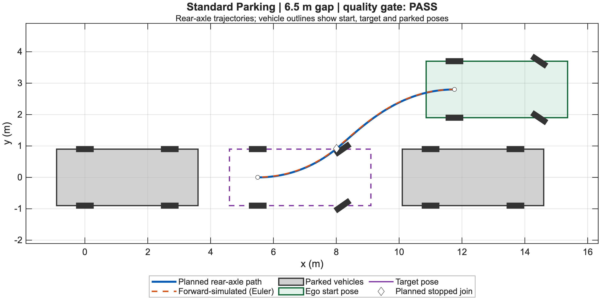
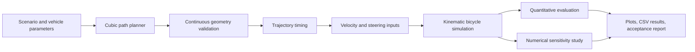
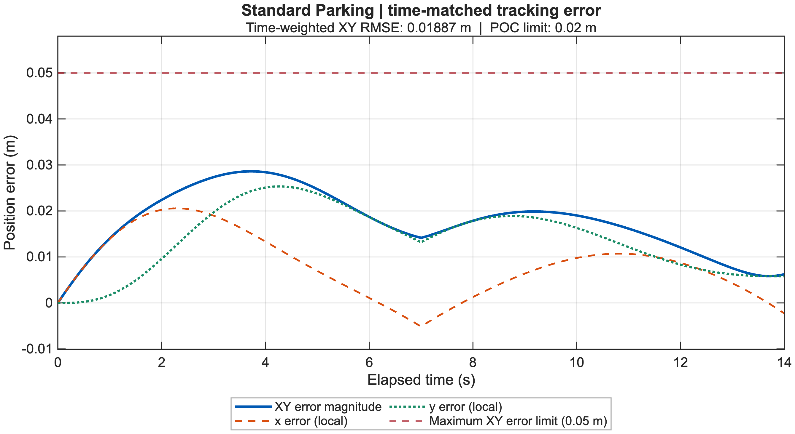
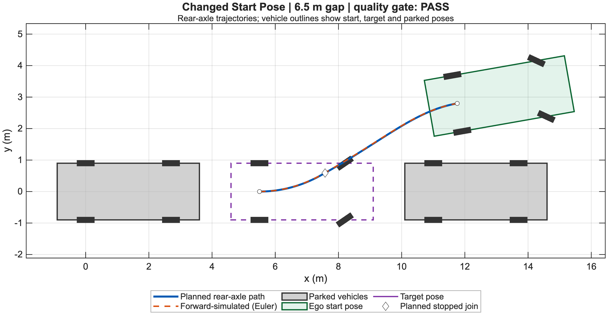

# Autonomous Parallel Parking in MATLAB

Trajectory-planning and simulation study for a car-like mobile robot, with curvature constraints, steering limits, forward-model validation, sensitivity analysis, and automated acceptance checks.



## At a glance

| | |
|---|---|
| **Goal** | Plan and validate a collision-aware parallel-parking maneuver for a kinematic bicycle model |
| **Stack** | MATLAB R2025b, Optimization Toolbox, MATLAB Unit Test |
| **Planner** | Bounded multistart search over two reverse cubic path segments |
| **Validation** | Continuous curvature checks, steering constraints, forward simulation, error metrics |
| **Quality evidence** | 470 automated tests passing; reproducible plots and CSV summaries included |

## Architecture



The planner and simulator are deliberately separate: the planner proposes a geometric path, while an independent forward simulation verifies that the generated steering and velocity commands reproduce it within the acceptance limits.

## Results

| Scenario | Planner result | Path length | Final position error | Time-weighted XY RMSE | Classification |
|---|---:|---:|---:|---:|---|
| Standard parking, 6.5 m space | Feasible | 7.032 m | 0.0062 m | 0.0189 m | Accepted proof of concept |
| Changed start pose | Feasible | 6.943 m | 0.0004 m | 0.0157 m | Accepted proof of concept |
| Tight parking, 5.5 m space | No validated plan found | — | — | — | Not evaluated |

The tight-space result applies only to the implemented two-reverse-cubic path family and bounded search. It is not a claim that the maneuver is physically impossible.

<p>
  
  
</p>

Detailed outputs are available in [`results/main/`](results/main/) and the consolidated acceptance evidence is in [`results/verification/final_acceptance.csv`](results/verification/final_acceptance.csv).

## Engineering highlights

- Modeled car-like motion with a kinematic bicycle model.
- Enforced maximum steering angle, curvature, turning-radius, boundary, and collision constraints.
- Refined geometry continuously instead of accepting sample-only checks.
- Converted geometric paths into timed steering and longitudinal-velocity commands.
- Quantified final-pose error, time-matched error, RMSE, geometric deviation, and steering margin.
- Verified first-order numerical convergence through sample-time sensitivity experiments.
- Built a broad automated test suite covering geometry, planning, transforms, timing, simulation, evaluation, reproducibility, and failure cases.

## Main workflow

[`runParkingExperiments.m`](runParkingExperiments.m) is the primary entry point:

```matlab
runParkingExperiments
```

It executes the three report scenarios and writes new outputs to `results/step10/`. Existing outputs are protected from accidental replacement unless overwrite is explicitly enabled.

The optional numerical study is run separately:

```matlab
runParkingSensitivity
```

## Repository map

```text
Mobile-Robotics-Parallel-Parking/
├── runParkingExperiments.m        # End-to-end experiment runner
├── planCubicParking.m             # Bounded multistart planner
├── validateCubicGeometry.m        # Continuous feasibility checks
├── timeParkingPlan.m              # Trajectory timing
├── pathToInputs.m                 # Steering and velocity generation
├── simulateParkingPlan.m          # Independent forward simulation
├── evaluateParkingExperiment.m    # Metrics and acceptance checks
├── runParkingSensitivity.m        # Numerical convergence study
├── tests/                         # Automated MATLAB tests
└── results/                       # Included plots and verification evidence
```

## Model parameters

- Vehicle length: 4.50 m
- Vehicle width: 1.80 m
- Wheelbase: 2.70 m
- Maximum steering angle: ±35°
- Minimum turning radius: approximately 3.856 m

## Verification

Run the repository test suite from MATLAB:

```matlab
results = runtests("tests");
```

Verified clean-repository result: **470 passed, 0 failed, 0 incomplete**.

## Scope

This is a kinematic proof of concept. It does not model tire slip, steering actuator dynamics, perception uncertainty, moving obstacles, or vehicle-level safety supervision.
